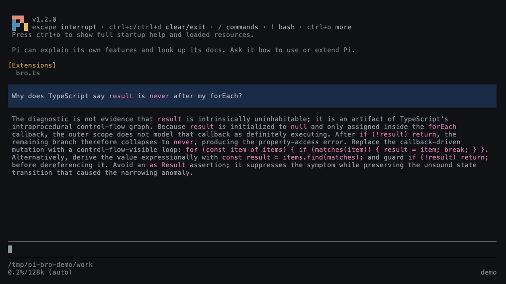

# pi-bro

[](https://www.npmjs.com/package/pi-bro)
[](https://github.com/tranhoangnguyen03/pi-bro/actions/workflows/publish.yml)
[](package.json)
[](LICENSE)

A sidekick for you and your Pi agent: plain-language explanations, side
questions, diagrams, PR review and second opinions, without cluttering the
agent's context.

`pi-bro` is an extension for [Pi](https://github.com/earendil-works/pi), a
terminal coding agent. Bro opens its answers in a separate window and runs
them through an AI coding CLI you already have and are signed in to, so your
main agent's conversation stays clean. Before you install, see
[what leaves your machine](#what-leaves-your-machine).

<p align="center">
  
</p>

## Install

```sh
pi install npm:pi-bro
```

Then restart Pi or run `/reload`, and check your setup:

```text
/bro doctor
```

To try Bro without installing it, run `pi -e npm:pi-bro`. To install from
GitHub, use `pi install git:github.com/tranhoangnguyen03/pi-bro`.

## Try it

For a first success, type this in Pi after setting up a backend:

```text
/bro text A request limit means a service allows only a certain number of calls in a given time.
```

**Expected:** Bro opens a separate window and explains that sentence in plain words. Close with **Esc**. Nothing is sent to your main agent's conversation. The exact words depend on your selected model.

| After that | What happens |
| --- | --- |
| `/bro` | Explains the agent's latest completed reply (requires one) |
| `/bro btw What is a race condition?` | Asks a private side question |
| `/bro show` | Draws the current session's recent conversation, if any |
| `/bro architecture` | Creates or refreshes `docs/architecture/` for this project |
| `/bro grill-me Should agents talk freely to each other?` | Questions your assumptions privately, one at a time |
| `/bro overthink` | Views private automatic second-look notes; Ctrl+R forces a new check |
| `/bro elevate Improve how we search company documents` | Find expert gaps before giving Pi a task |

File and webpage examples need your own real path or URL; see [how to explain them](docs/features/explain.md#explain-a-document). For a step-by-step first run, see [Getting started](docs/getting-started.md).

## What it does

| Command | What you get |
| --- | --- |
| `/bro`, `/bro text`, `/bro file`, `/bro url` | **[Explain](docs/features/explain.md).** A plain-language version of the agent's last reply, pasted text, a PDF/DOCX/Markdown file, or a public webpage. Three modes: `brief`, `balanced`, `faithful`. |
| `/bro show` | **[Show](docs/features/show.md#bro-show).** The last few turns drawn as a shape (call tree, file tree, diff, pseudocode, a sequence diagram, or an HTML layout) instead of prose. |
| `/bro architecture [focus]` | **[Architecture Docs](docs/features/architecture.md).** Inspects the project and writes Markdown, diagrams and an offline interactive `architecture.html` under `docs/architecture/`. Uses BTW model settings. |
| `/bro elevate` or **Ctrl+Shift+E** | **[Elevate](docs/elevate.md).** Discover missing expert considerations, select useful improvements, and rewrite your task without submitting it. Shares BTW backend settings. |
| `/bro remember-me [thought]` | **[Remember Me](docs/remember-me.md).** Privately clarify and approve short personal memories with unfoldable background. Agents can call `about_user` to read summaries and expand IDs. |
| `/bro overthink` | **[Overthink](docs/overthink.md).** Quietly checks meaningful work with the active Pi model, using editable global/session questions and a private notes modal. Automatic checks can be switched off in config. No separate backend. |
| `/bro grill-me` | **[Grill Me](docs/grill-me.md) (experimental).** A private, opinionated decision interview: light, balanced or exhaustive; one question per round; `/consolidate` drafts a brief without ending the interview; `/copy` returns the latest reply or decision brief to the clipboard. Uses BTW model settings; read-only restrictions vary by backend. |
| `/bro btw` | **[Side questions](docs/features/btw.md#bro-btw-side-conversation).** A separate conversation seeded with recent context, so you can ask without interrupting the agent. ⚠️ [Full-permission mode](#what-leaves-your-machine) can edit files. |
| `/bro guided-review <PR>` | **[Guided Review](docs/guided-review.md).** An explanation and quality assessment of a GitHub PR, with ranked findings, source evidence and private questions. Claude, Muse, or Pi is recommended for untrusted PRs. |
| `bro_advisor` tool | **[Second opinion](docs/features/advisor.md#bro-advisor).** A tool your agent can call mid-task; a fresh backend process reviews the session snapshot, can inspect the workspace when needed, and returns advice to the agent. ⚠️ [Runs with permissions bypassed](#what-leaves-your-machine). |
| `/bro config`, `/bro preferences` | **[Settings](docs/reference/settings.md#settings) and [preferences](docs/user-guide.md#preferences).** Pick the backend, model and effort per feature, and tell Bro how you like answers. |

For help by task, start with the **[four human-intent states](docs/feature-map.md)** or the **[docs home](docs/README.md)**; see the [command reference](docs/reference/commands.md) for syntax.
**Elevate, in practice:** Bro points out expert questions or tests you may have missed before you ask Pi to do the work. Review the suggestions, approve only what matters, then edit or submit the resulting request yourself. See the [walkthrough](docs/elevate.md) for limits, privacy, and copy-only handoff.

Guided Review has its own [guide](docs/guided-review.md).

## Requirements

- Pi `>=1.3.0` and Node.js `>=22.19.0`. Overthink always uses the host Pi model, independently of Bro's backend configuration.
- macOS or Linux. Windows is untested; there, cancelling stops only the
  backend's direct process, not anything it started.
- At least one backend on your `PATH`, signed in once from your terminal, **or the built-in Pi backend**. You only need the one you use:

| Backend | CLI | Notes |
| --- | --- | --- |
| [Google Antigravity](https://antigravity.google/docs/cli-install) | `agy` | Default for new settings. Needs `>=1.1.15`. Guided Review uses `--sandbox`, which restricts shell commands but still allows writes inside the project. |
| [Claude Code](https://docs.anthropic.com/en/docs/claude-code) | `claude` | Works for every feature; strict file-only inspection for Guided Review. |
| [Grok Build](https://docs.x.ai/build/overview) | `grok` | Guided Review uses its read-only sandbox (shell-enabled). |
| [Codex CLI](https://github.com/openai/codex) | `codex` | Guided Review uses its read-only sandbox (shell-enabled). |
| [Muse Code](https://dev.meta.ai/docs/muse-code) | `muse` | Works for every feature; strict file-only inspection for Guided Review. |
| **Pi** (in-process) | none | Runs a Pi SDK session inside this process using your Pi models and credentials. No extra install. Restricted features get no tools; Guided Review is file-only; the advisor and full-access BTW get workspace tools. |

- Guided Review also needs Git and an authenticated [`gh`](https://cli.github.com/).
  Claude, Muse, or Pi is recommended for untrusted PRs (strict file-only inspection); Codex, Grok and Agy run with shell available under their sandbox, with an advisory.
- [PiG](docs/pig-compatibility.md) support is experimental.

## What leaves your machine

Each feature sends data to the backend you chose and its model provider,
which may keep it under their own policies. Paths below are under
`~/.pi/agent/` (or `$PI_CODING_AGENT_DIR`).

| Feature | What is sent | What Bro keeps on disk |
| --- | --- | --- |
| Explain | The agent's last reply, your pasted text, or text extracted from your file or webpage, plus your preferences | Last result as a private Pi session entry |
| Architecture Docs | Repository source, existing architecture docs, focus and preferences; only selected backend can see snapshot files | Generated Markdown, JSON graph and offline HTML in `docs/architecture/`; temporary inspection copy is removed |
| Show | User and assistant text from recent turns (no tool calls, tool results, reasoning or images), plus your preferences | Last result in the private Pi session, plus temporary diagram pages in `pi-bro-<uid>/` |
| Side questions | Your questions and up to the last 8 turns of conversation text, plus your preferences | Private Pi session entries with completed turns, mode and draft |
| Grill Me | Topic, interview turns, up to the last 8 main-session text turns and preferences; any workspace files the selected inspector reads | Private Pi session entries with the interview and brief |
| Overthink | Current session projection, including tool evidence, plus private user-editable questions, to the active Pi provider | Global questions in `bro-overthink-defaults.json`; per-session questions and latest private note in Pi session custom entries |
| Elevate | Your objective, selected findings, all current-branch user/assistant text; Full also includes tool-call arguments and text results, and preferences | Nothing; the workflow stays in memory |
| Guided Review | The PR description and diff, the files the backend reads, your questions, plus your preferences | Reviews and captured source in `bro-reviews/`, with no automatic cleanup |
| Advisor | The agent's system instructions, tool list and whole conversation, including tool calls and results (reasoning and images omitted), plus your steering | Steering in `bro-advisor.md` and the session file |

Session-scoped Bro entries live **inside Pi's session file**. They stay out of the model's conversation, but are not secret from someone who can read, back up, export, or share that file. Check the session content before sharing it; this feature does not encrypt or redact exports.

`/bro url` also connects straight to the website, which sees your IP address.
Bro runs each CLI as you, with your environment. It never reads or copies an
external CLI's provider credentials, but a CLI signs in its own way, which can
include API keys set in your environment. The built-in **Pi** backend is the
exception: it runs in-process, so it reads your Pi `auth.json` and reuses your
Pi provider credentials for the model you select. Nothing Bro produces enters
Pi's conversation unless you paste and submit it, except advisor answers, which return to
the agent as tool results.

> [!WARNING]
> These run the backend in your workspace with its permission checks bypassed:
> - **Advisor:** it can read, edit and run commands. "Advise, don't edit" is
>   only an instruction.
> - **Grill Me `/access full`:** explicitly opts into unrestricted workspace permissions. The no-edits prompt is not an access control.
> - **BTW full-permission mode** (turned on with `/mode` inside BTW): it is
>   meant to edit files and run commands.
> - **Grok:** its sandbox is off except during Guided Review, which uses the
>   read-only sandbox. "Answer only from the supplied context" is only an
>   instruction.

Details per backend:
[Backends: access and retention](docs/reference/data-and-permissions.md#backends-access-and-retention)
and [Privacy and safety](docs/reference/data-and-permissions.md#privacy-and-safety).

## Limits

- Documents: `.md`, `.markdown`, `.txt`, `.pdf`, `.docx` only, no OCR, up to 10 MiB.
  → Run OCR elsewhere first.
- Webpages: one public HTML page; no logins, paywalls, page JavaScript or
  proxy settings. → Save the page as PDF or text and use `/bro file`.
- No fallback: if the chosen backend, model or effort fails, Bro shows that
  backend's error instead of switching. → Run `/bro doctor`.
- Elevate runs fresh restricted calls through the BTW model setting. Restricted does not always mean sandboxed; see [access and retention](docs/reference/data-and-permissions.md). The shortcut may not work in all terminals: use `/bro elevate` instead.
- BTW, Grill Me and the latest explanation/Show result use private session entries; they survive normal Pi reload/resume. A new session starts fresh and later fork changes stay separate. Abrupt crashes during active calls are not guaranteed.
- Guided Review runs in local interactive Pi only and does not post to
  GitHub.

Full list: [Troubleshooting and current limits](docs/reference/troubleshooting.md#troubleshooting-and-current-limits).

## Stability

Bro is `0.x`: a minor version can change commands or settings. Breaking
changes are listed under **Breaking** in the [changelog](CHANGELOG.md) and the
[release notes](https://github.com/tranhoangnguyen03/pi-bro/releases). Each
release is published to npm from CI with
[provenance](https://docs.npmjs.com/generating-provenance-statements).

## Contributing

```sh
npm ci
npm test        # offline: uses fake backend CLIs, never calls a model
pi --tui-mode fullscreen -e ./src/bro.ts
```

See [CONTRIBUTING.md](CONTRIBUTING.md), the [code map](docs/DEVELOPMENT.md)
and the [docs index](docs/README.md). Report security problems privately as
described in [SECURITY.md](SECURITY.md).

## License

MIT. See [LICENSE](LICENSE) and [THIRD_PARTY_NOTICES.md](THIRD_PARTY_NOTICES.md).
